<!-- Enlace «volver arriba» compatible con GitHub: https://github.com/othneildrew/Best-README-Template/pull/73 -->
<a id="readme-top"></a>

<!-- INSIGNIAS DEL PROYECTO -->
[![Contribuidores][contributors-shield]][contributors-url]
[![Forks][forks-shield]][forks-url]
[![Estrellas][stars-shield]][stars-url]
[![Issues][issues-shield]][issues-url]
[![Licencia][license-shield]][license-url]


<!-- LOGO -->
<br />
<div align="center">
  <a href="https://github.com/SebaGRT/SpinTCG">
    
  </a>

  <h3 align="center">SpinTCG</h3>

  <p align="center">
    Juego de cartas coleccionables de tenis para Android, con estadísticas reales de tenistas ATP.
    <br />
    <a href="docs/"><strong>Explorar la documentación »</strong></a>
    <br />
    <br />
    <a href="#uso">Ver capturas</a>
    &middot;
    <a href="https://github.com/SebaGRT/SpinTCG/issues/new?labels=bug">Reportar un error</a>
    &middot;
    <a href="https://github.com/SebaGRT/SpinTCG/issues/new?labels=enhancement">Proponer una mejora</a>
  </p>
</div>


<!-- ÍNDICE -->
<details>
  <summary>Índice</summary>
  <ol>
    <li>
      <a href="#acerca-del-proyecto">Acerca del proyecto</a>
      <ul>
        <li><a href="#construido-con">Construido con</a></li>
      </ul>
    </li>
    <li>
      <a href="#primeros-pasos">Primeros pasos</a>
      <ul>
        <li><a href="#requisitos-previos">Requisitos previos</a></li>
        <li><a href="#instalación">Instalación</a></li>
      </ul>
    </li>
    <li><a href="#uso">Uso</a></li>
    <li><a href="#hoja-de-ruta">Hoja de ruta</a></li>
    <li><a href="#contribuir">Contribuir</a></li>
    <li><a href="#licencia">Licencia</a></li>
    <li><a href="#contacto">Contacto</a></li>
    <li><a href="#agradecimientos">Agradecimientos</a></li>
  </ol>
</details>


<!-- ACERCA DEL PROYECTO -->
## Acerca del proyecto

<div align="center">
  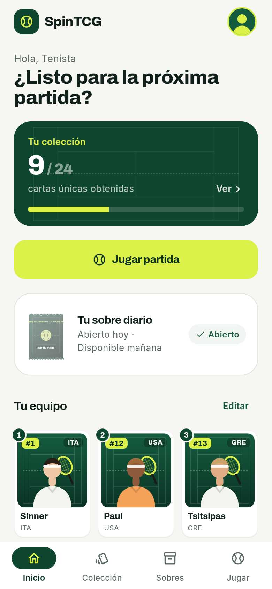
  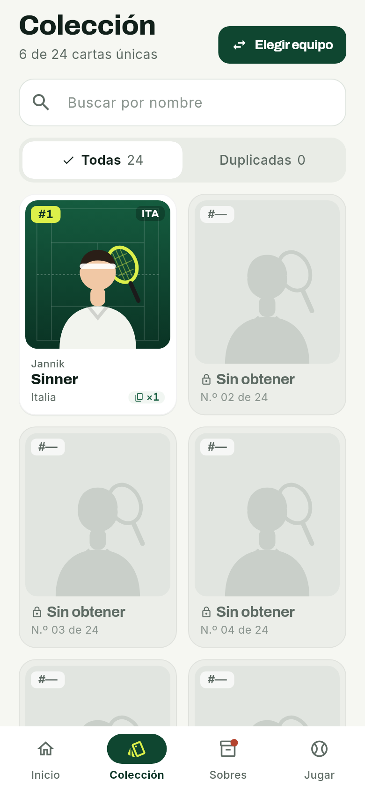
  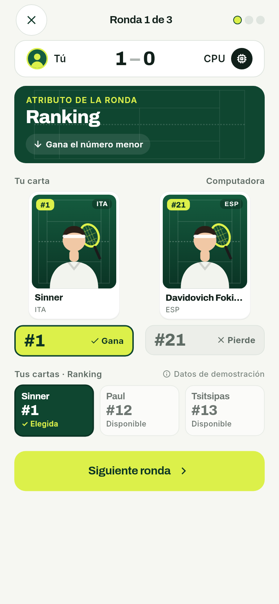
</div>
<br />

**SpinTCG** es un TCG (*trading card game*) de tenis hecho en Flutter. Cada carta es un tenista del top 24 del ranking ATP, con tres estadísticas reales: **ranking**, **títulos** y **% de victorias** en su carrera. Es el proyecto del ramo **IIP323W · Tecnologías y Aplicaciones Web y Móviles** de la Universidad del Desarrollo (2026).

Qué se puede hacer:
* **Coleccionar:** la primera vez recibes 6 cartas al azar. Cada día puedes abrir un **sobre** con 3 cartas más, y las repetidas se acumulan como copias.
* **Armar un equipo** de 3 tenistas y jugar **partidas de 3 rondas** contra la computadora. Ronda 1: gana el ranking menor. Ronda 2: más títulos. Ronda 3: mayor % de victorias. Cada carta se usa una sola vez.
* **Seguir tu progreso:** perfil con apodo, partidas jugadas y victorias. El progreso queda guardado en el teléfono y funciona sin internet después de la primera carga.
* **Tener una cuenta:** registro e ingreso con Supabase. Tus **equipos guardados** quedan en la nube: puedes crearlos, verlos, cambiarles el nombre, borrarlos y volver a usarlos.
* **Consultar el ranking ATP** pedido en el momento a la API de tenis.

**Por qué hay un servidor intermedio:** la clave de RapidAPI no puede ir dentro de la app, porque cualquiera podría sacarla de la APK. La app le pide el catálogo a un servidor Node propio (`app_flutter/servidor_api/`). Ese servidor tiene la clave, consulta la API, valida los datos y los guarda 24 h en caché, para no pasarse de la cuota del plan gratis.

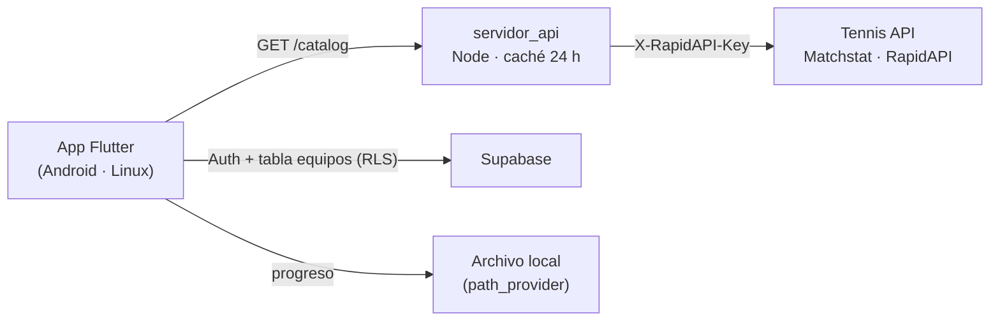

**Requisitos del curso y dónde se cumplen:**

| Requisito | En SpinTCG |
|---|---|
| Login con Supabase (registrarse, entrar y salir) | `login_page.dart` (`AuthGate` + formulario) y «Salir» en `account_page.dart` |
| Datos de una API de deportes con `FutureBuilder` | `ranking_page.dart`: ranking ATP desde la Tennis API |
| Tocar un elemento abre su detalle (dato por el constructor) | Colección → `DetailPage(app: app, card: card)` |
| Hero y animaciones implícitas | `widgets/card_hero.dart` (carta de Colección a Detalle); `AnimatedContainer` y `AnimatedOpacity` en `team_page.dart` |
| Tabla en Supabase por usuario, con RLS y CRUD | Tabla `equipos` (`supabase/equipos.sql`), con 4 políticas RLS |
| `Form` y `TextFormField` con `validator` | Ingreso y registro; nombre del equipo (`widgets/team_name_dialog.dart`) |
| Estado con Provider | `MultiProvider` en `main.dart`: `AppController` y `SessionController` compartidos |
| Widgets propios en archivos separados | `lib/presentation/widgets/` |
| GitHub con commits de todos | [Contribuidores](https://github.com/SebaGRT/SpinTCG/graphs/contributors) |

El diseño sigue el mockup **Court Cards**, con la marca cambiada a SpinTCG. Las diferencias declaradas con el mockup están en el [índice de guías](docs/guias/README.md#qué-cambia-respecto-del-mockup).

<p align="right">(<a href="#readme-top">volver arriba</a>)</p>


### Construido con

* [![Flutter][Flutter-badge]][Flutter-url]
* [![Dart][Dart-badge]][Dart-url]
* [![Supabase][Supabase-badge]][Supabase-url]
* [![Node.js][Node-badge]][Node-url]
* [![RapidAPI][RapidAPI-badge]][RapidAPI-url]
* [![Android][Android-badge]][Android-url]

Paquetes de Flutter: [`provider`](https://pub.dev/packages/provider), [`supabase_flutter`](https://pub.dev/packages/supabase_flutter), [`http`](https://pub.dev/packages/http) y [`path_provider`](https://pub.dev/packages/path_provider). El servidor usa solo Node.js, sin dependencias externas.

<p align="right">(<a href="#readme-top">volver arriba</a>)</p>


<!-- PRIMEROS PASOS -->
## Primeros pasos

La app tiene tres modos, y cada uno necesita un poco más de configuración que el anterior:

| Modo | Qué necesitas | Qué ves |
|---|---|---|
| **Demo** | Solo Flutter | 24 cartas con estadísticas ficticias (marcadas «Datos demo»), sin cuenta |
| **Datos reales** | + el servidor con una clave de RapidAPI | Las cartas con las estadísticas reales del ranking ATP |
| **Completo** (entrega) | + `supabase.json` | Lo anterior, más el ingreso y los equipos guardados |

### Requisitos previos

* **Flutter 3.47** o superior (Dart 3.8 o superior)
  ```sh
  flutter --version
  flutter doctor
  ```
* **Android Studio** con el Android SDK y un emulador (usamos *Medium Phone API 37*). En fish, para tener `adb` en la terminal:
  ```sh
  fish_add_path ~/Android/Sdk/platform-tools ~/Android/Sdk/emulator
  ```
* **Node.js 22** o superior (solo para el modo con datos reales)
  ```sh
  node --version
  ```
* Una cuenta de **RapidAPI** suscrita a [Tennis API - ATP WTA ITF][RapidAPI-url]. El plan gratis alcanza: 50 consultas por día, y una actualización completa usa 25.
* Un proyecto de **Supabase** (el plan gratis alcanza).

### Instalación

1. Clona el repositorio e instala los paquetes:
   ```sh
   git clone https://github.com/SebaGRT/SpinTCG.git
   cd SpinTCG/app_flutter
   flutter pub get
   ```
2. **Supabase.** En el panel del proyecto:
   * *SQL Editor*: ejecuta [`supabase/equipos.sql`](supabase/equipos.sql). Crea la tabla `equipos` y sus políticas RLS.
   * *Authentication → Sign In / Providers → Email*: desactiva **Confirm email**. El correo gratis de Supabase envía muy pocos mensajes por hora.
   * *Project Settings → API Keys*: copia la **Publishable key** (o la `anon` `public`). **Nunca** la `secret` ni la `service_role`.
3. Crea `app_flutter/supabase.json`. Ya está en `.gitignore`:
   ```json
   {
     "SUPABASE_URL": "https://<ref>.supabase.co",
     "SUPABASE_PUBLISHABLE_KEY": "sb_publishable_..."
   }
   ```
4. **Servidor con datos reales.** La clave se escribe en la terminal sin que se vea, y no queda guardada en ningún archivo:
   ```sh
   cd app_flutter/servidor_api
   # fish
   read --silent --export --prompt-str 'Clave RapidAPI: ' RAPIDAPI_KEY
   # bash
   read -rsp 'Clave RapidAPI: ' RAPIDAPI_KEY && export RAPIDAPI_KEY

   node server.mjs
   curl http://127.0.0.1:8787/health      # {"ok":true,"keyConfigured":true}
   ```
   El servidor escucha solo en `127.0.0.1:8787` y guarda el catálogo en `.local/` por 24 h.

<p align="right">(<a href="#readme-top">volver arriba</a>)</p>


<!-- USO -->
## Uso

Desde `app_flutter/`:

```sh
# Demo, en el computador
flutter run -d linux

# Completo, en el computador
flutter run -d linux --dart-define-from-file=supabase.json --dart-define=API_BASE_URL=http://127.0.0.1:8787

# Completo, en el emulador o en un teléfono por USB
adb reverse tcp:8787 tcp:8787          # el puerto 8787 del Android llega a tu computador
flutter run -d emulator-5554 --dart-define-from-file=supabase.json --dart-define=API_BASE_URL=http://127.0.0.1:8787
```

**APK de entrega.** Es debug porque el servidor local usa `http://`, que Android solo permite en debug.

```sh
flutter build apk --debug --dart-define-from-file=supabase.json --dart-define=API_BASE_URL=http://127.0.0.1:8787
adb install -r build/app/outputs/flutter-apk/app-debug.apk
```

**Pruebas:**

```sh
cd app_flutter && flutter analyze && flutter test        # 20 pruebas: reglas, progreso, catálogo, interfaz y cuenta
cd app_flutter/servidor_api && node --test adapter.test.mjs
```

**Recorrido:** Inicio → Abrir sobre → revelar las 3 cartas → Colección → Elegir equipo → Jugar → 3 rondas → Resultado. En el Perfil están el Ranking ATP y la Cuenta con los equipos guardados.

| | | | |
|:---:|:---:|:---:|:---:|
| 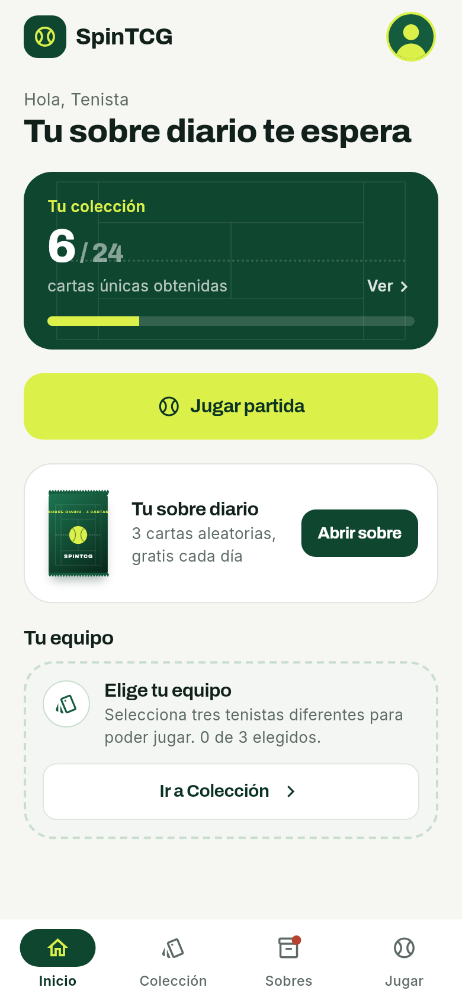<br>Inicio | 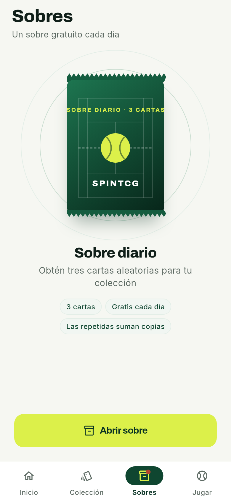<br>Sobre diario | 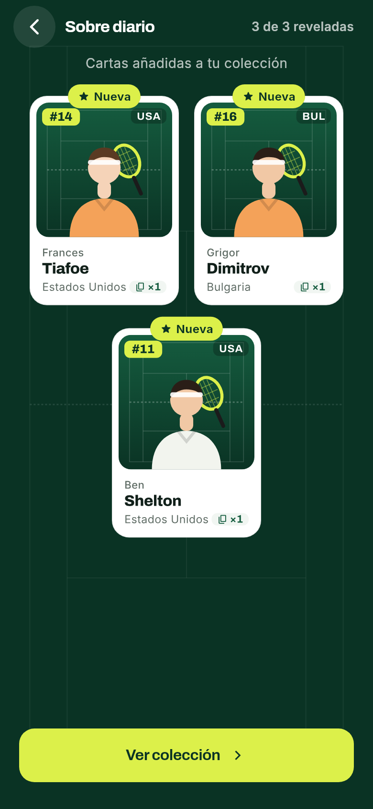<br>Revelación | 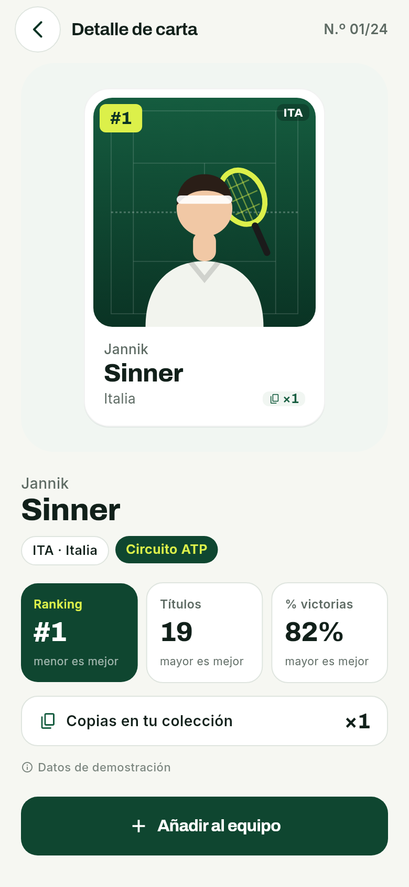<br>Detalle |
| 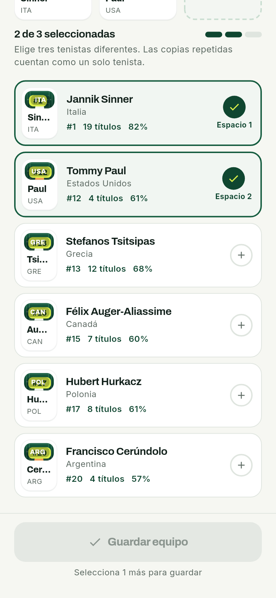<br>Elegir equipo | 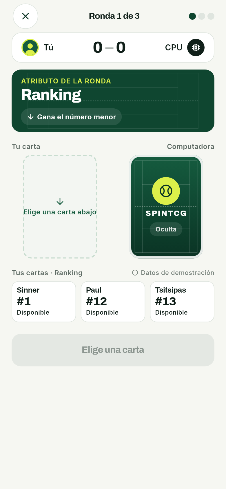<br>Partida | 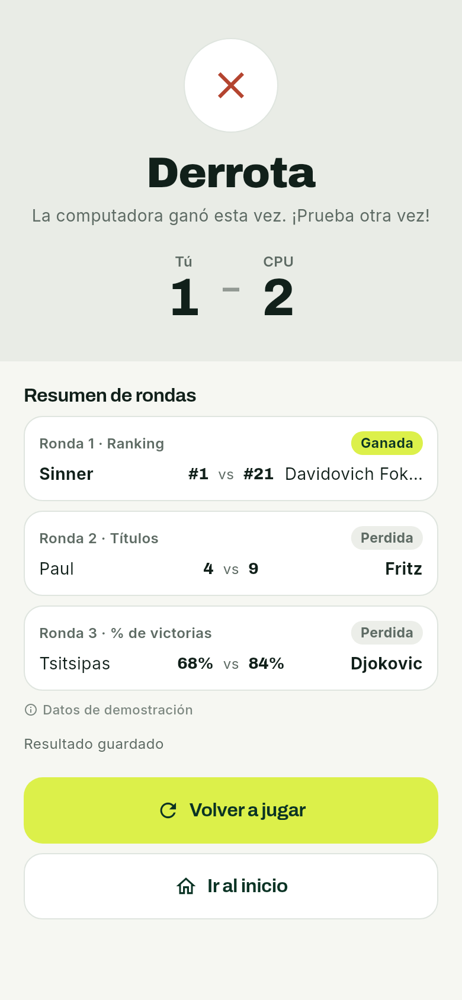<br>Resultado | 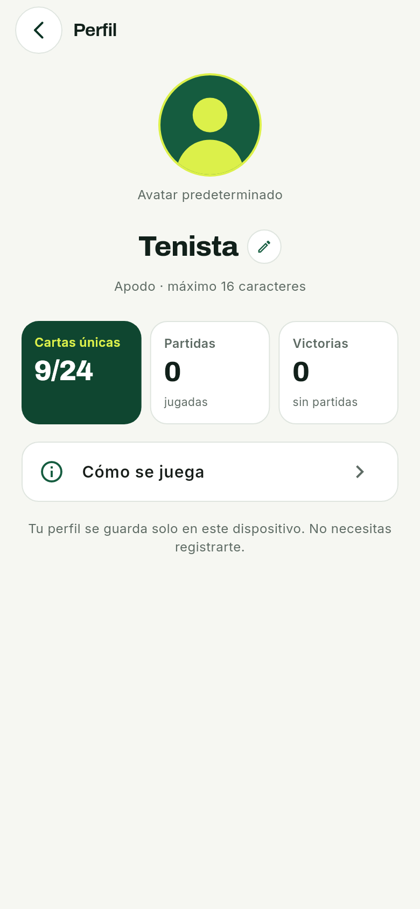<br>Perfil |

_Más detalles: la arquitectura está en [`docs/kit/01-arquitectura.md`](docs/kit/01-arquitectura.md), la revisión de la API en [`docs/api-tennis.md`](docs/api-tennis.md) y la evidencia de pruebas en [`docs/evidencia/`](docs/evidencia/)._

<p align="right">(<a href="#readme-top">volver arriba</a>)</p>


<!-- HOJA DE RUTA -->
## Hoja de ruta

- [x] Catálogo, colección y sobre diario
- [x] Partidas de 3 rondas contra la computadora
- [x] Servidor intermedio con caché y presupuesto de consultas
- [x] Progreso local que sobrevive al reinicio y funciona sin internet
- [x] Cuenta de Supabase y equipos guardados con RLS
- [x] Ranking ATP con `FutureBuilder`, Hero y animaciones implícitas
- [ ] Publicar el servidor con HTTPS, para compilar una APK *release*
- [ ] Cartas de tenistas de la WTA
- [ ] Partidas entre dos jugadores
- [ ] Guardar también el progreso en la cuenta, para seguir jugando en otro teléfono

**Limitaciones conocidas:**
* La APK es *debug* porque el servidor es local y usa `http://`.
* El sobre diario usa la fecha del teléfono: cambiar la hora del dispositivo permite abrir otro.
* Con el plan gratis de RapidAPI cabe una actualización completa del catálogo por día.

Ver los [issues abiertos](https://github.com/SebaGRT/SpinTCG/issues) para la lista completa.

<p align="right">(<a href="#readme-top">volver arriba</a>)</p>


<!-- CONTRIBUIR -->
## Contribuir

SpinTCG es un proyecto académico: solo los integrantes del equipo suben código. Igual puedes [abrir un issue](https://github.com/SebaGRT/SpinTCG/issues) para reportar errores o proponer mejoras.

Así trabaja el equipo:

1. Una rama por tarea, con tu nombre (`git switch -c nombre/diaN-tema`)
2. Antes de cada commit, revisar que todo esté en verde (`dart format lib test && flutter analyze && flutter test`)
3. Commit con un mensaje que diga qué cambia (`git commit -m 'Pantalla Resultado que guarda la partida'`)
4. Subir la rama (`git push -u origin nombre/diaN-tema`)
5. Abrir un Pull Request (`gh pr create --fill`). Sebastián lo integra a `main`

Las guías de código de cada integrante están en [`docs/guias/`](docs/guias/README.md).

### Contribuidores

<a href="https://github.com/SebaGRT/SpinTCG/graphs/contributors">
  
</a>

<p align="right">(<a href="#readme-top">volver arriba</a>)</p>


<!-- LICENCIA -->
## Licencia

Sin licencia. Es un proyecto académico y sus autores se reservan todos los derechos: el código se puede leer, pero no copiar, modificar ni distribuir sin su permiso.

Los datos de tenistas son de [Matchstat](https://tennisapidoc.matchstat.com/) y se usan según los términos de su API. Las fuentes Archivo e Inter tienen licencia [SIL Open Font License](https://openfontlicense.org/).

<p align="right">(<a href="#readme-top">volver arriba</a>)</p>


<!-- CONTACTO -->
## Contacto

* **Sebastián Herrera S.**, coordinación e integración: [@SebaGRT](https://github.com/SebaGRT) · s.herreras@udd.cl
* **Emma Westcott S.**, interfaz y navegación: [@EmmaUDD](https://github.com/EmmaUDD) · e.westcotts@udd.cl
* **Miguel Figueroa G.**, sobres, perfil y validación: [@FGEMiguel](https://github.com/FGEMiguel) · m.figueroag@udd.cl

Enlace del proyecto: [https://github.com/SebaGRT/SpinTCG](https://github.com/SebaGRT/SpinTCG)

<p align="right">(<a href="#readme-top">volver arriba</a>)</p>


<!-- AGRADECIMIENTOS -->
## Agradecimientos

* [Universidad del Desarrollo](https://www.udd.cl/), ramo IIP323W · Tecnologías y Aplicaciones Web y Móviles
* [Tennis API de Matchstat](https://tennisapidoc.matchstat.com/), por los datos del ranking y las estadísticas ATP
* [Supabase](https://supabase.com/docs), por la autenticación y la base de datos
* [Documentación de Flutter](https://docs.flutter.dev/)
* [Google Fonts](https://fonts.google.com/): [Archivo](https://fonts.google.com/specimen/Archivo) e [Inter](https://fonts.google.com/specimen/Inter)
* [Best-README-Template](https://github.com/othneildrew/Best-README-Template), la plantilla de este README
* [Shields.io](https://shields.io) y [contrib.rocks](https://contrib.rocks), por las insignias y la imagen de contribuidores

<p align="right">(<a href="#readme-top">volver arriba</a>)</p>


<!-- ENLACES E IMÁGENES EN ESTILO REFERENCIA -->
[contributors-shield]: https://img.shields.io/github/contributors/SebaGRT/SpinTCG.svg?style=for-the-badge
[contributors-url]: https://github.com/SebaGRT/SpinTCG/graphs/contributors
[forks-shield]: https://img.shields.io/github/forks/SebaGRT/SpinTCG.svg?style=for-the-badge
[forks-url]: https://github.com/SebaGRT/SpinTCG/network/members
[stars-shield]: https://img.shields.io/github/stars/SebaGRT/SpinTCG.svg?style=for-the-badge
[stars-url]: https://github.com/SebaGRT/SpinTCG/stargazers
[issues-shield]: https://img.shields.io/github/issues/SebaGRT/SpinTCG.svg?style=for-the-badge
[issues-url]: https://github.com/SebaGRT/SpinTCG/issues
[license-shield]: https://img.shields.io/badge/licencia-sin%20licencia-lightgrey.svg?style=for-the-badge
[license-url]: #licencia
[Flutter-badge]: https://img.shields.io/badge/Flutter-02569B?style=for-the-badge&logo=flutter&logoColor=white
[Flutter-url]: https://flutter.dev/
[Dart-badge]: https://img.shields.io/badge/Dart-0175C2?style=for-the-badge&logo=dart&logoColor=white
[Dart-url]: https://dart.dev/
[Supabase-badge]: https://img.shields.io/badge/Supabase-3FCF8E?style=for-the-badge&logo=supabase&logoColor=white
[Supabase-url]: https://supabase.com/
[Node-badge]: https://img.shields.io/badge/Node.js-5FA04E?style=for-the-badge&logo=nodedotjs&logoColor=white
[Node-url]: https://nodejs.org/
[RapidAPI-badge]: https://img.shields.io/badge/RapidAPI-0055DA?style=for-the-badge&logo=rapid&logoColor=white
[RapidAPI-url]: https://rapidapi.com/jjrm365-kIFr3Nx_odV/api/tennis-api-atp-wta-itf
[Android-badge]: https://img.shields.io/badge/Android-34A853?style=for-the-badge&logo=android&logoColor=white
[Android-url]: https://developer.android.com/
